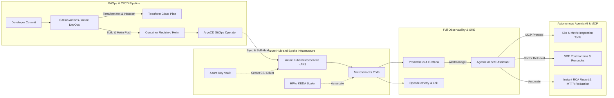

<div align="center">

# Hi there, I'm Mithilesh Yadav 👋
### Enterprise DevOps & SRE Engineer | Agentic AI & LLMOps Systems

[](https://www.linkedin.com/)
[](mailto:mit9685@gmail.com)
[](https://maps.google.com/?q=Noida,India)
[](#-professional-journey)

<p align="center">
  
</p>

</div>

---

## 👨‍💻 Executive Summary

DevOps & SRE Engineer with **6.8+ years of overall experience** (including **5+ years of dedicated DevOps/SRE experience**) architecting, scaling, and automating mission-critical infrastructure in **hybrid cloud** and **Microsoft Azure** environments.

Specialized in:
- ☸️ **Kubernetes & Azure Kubernetes Service (AKS)**: Multi-cluster orchestration, Helm packaging, zero-downtime rolling deployments, and event-driven autoscaling (**HPA & KEDA**).
- 📜 **Infrastructure as Code (IaC)**: Production Terraform modules implementing secure **Hub-and-Spoke** topologies, Key Vault secret bindings, and drift management.
- 🔄 **GitOps Continuous Delivery**: End-to-end automation with **ArgoCD**, **Azure DevOps Pipelines**, and **GitHub Actions** across multi-environment lifecycles (**Dev, SIT, UAT, Production**).
- 📊 **Observability & SRE Reliability**: Full-stack telemetry using **Prometheus, Grafana, OpenTelemetry, Jaeger, and Loki**, actively monitoring Golden Signals, SLIs/SLOs, and error budget burn rates to drive down **MTTR**.
- 🤖 **Agentic AI & LLMOps Engineering**: Building next-generation Autonomous DevOps SRE agents, **Model Context Protocol (MCP)** servers, and **Retrieval-Augmented Generation (RAG)** pipelines for automated log analysis and instant incident RCA.

---

## 🛠️ Technical Arsenal

<div align="center">

### ☁️ Cloud & Infrastructure as Code


### 🔄 CI/CD, GitOps & Orchestration


### 📊 Observability, SRE & FinOps


### 🤖 Agentic AI, LLMOps & Automation


### 🛡️ Security & Cloud Middleware


</div>

---

## 🏛️ System Architecture Blueprints



---

## 🌟 Featured Engineering Repositories

| Repository | Focus Area | Tech Stack | Highlights |
| :--- | :--- | :--- | :--- |
| 🤖 [**`agentic-devops-mcp-agent`**](https://github.com/Mit-Yadav/agentic-devops-mcp-agent) | **Agentic AI & SRE Automation** | Python, MCP, RAG, FastAPI, Helm | Autonomous SRE agent implementing Model Context Protocol tools to triage Kubernetes OOMKills, query Golden Signals, and produce instant executive RCAs. |
| ☸️ [**`azure-aks-enterprise-gitops`**](https://github.com/Mit-Yadav/azure-aks-enterprise-gitops) | **Cloud & GitOps Architecture** | Terraform, AKS, ArgoCD, Prometheus, Infracost | Production Azure reference architecture with Hub-and-Spoke VNet peering, ArgoCD multi-environment release automation, HPA/KEDA, and full observability. |
| ☁️ [**`azure-terraform-modular-infra`**](https://github.com/Mit-Yadav/azure-terraform-modular-infra) | **Infrastructure as Code** | Terraform, Azure, Key Vault, Linux | Modular, reusable Terraform child modules (VNet, Subnet, NSG, NIC, Public IP, VM) with zero hardcoded credentials and GitHub Actions CI/CD. |
| 🔄 [**`terraform-code_CICD`**](https://github.com/Mit-Yadav/terraform-code_CICD) | **Automated CI/CD** | GitHub Actions, Terraform, AzureRM | Multi-stage declarative pipeline (`init` -> `plan` -> `apply`) for zero-touch cloud provisioning. |
| 📦 [**`Ekart`**](https://github.com/Mit-Yadav/Ekart) | **Microservices Delivery** | Docker, Jenkins, Kubernetes, Java | Containerized multi-tier e-commerce microservices with automated deployment pipelines. |
| 🚀 [**`argocd-example-apps`**](https://github.com/Mit-Yadav/argocd-example-apps) | **GitOps Patterns** | ArgoCD, Helm, Kustomize, K8s | Reference GitOps deployment strategies including blue-green, canary, and sync waves. |

---

## 💼 Professional Experience Overview

```
📅 Aug 2025 – Present
🏢 Jasper Colin Research Pvt. Ltd. | Enterprise DevOps Engineer
• Architect and manage hybrid cloud infrastructure running Kubernetes & Azure AKS for microservices.
• Provision Azure resources via Terraform (VMs, VNets, Subnets, NSGs, Key Vault, AKS, PostgreSQL).
• Champion GitOps-driven CI/CD across Dev, SIT, UAT, and Prod using Azure DevOps & ArgoCD.
• Reduce MTTR through root-cause analysis (RCA), SLI/SLO monitoring, and automated observability.

📅 Jan 2023 – Aug 2025
🏢 Niscom Tele Infra Pvt. Ltd. | DevOps Engineer
• Maintained production Kubernetes & AKS clusters ensuring 99.9% uptime and high availability.
• Configured Horizontal Pod Autoscaling (HPA) and rolling updates for traffic peaks.
• Implemented Prometheus & Grafana monitoring stacks and Terraform on Hub-and-Spoke network topologies.

📅 Nov 2021 – Jan 2023
🏢 Valu-Connex Tele Services Pvt. Ltd. | Deployment Engineer
• Deployed 5G Core containerized network functions (CNFs: PCC, NRF, UDM, UDR) on Kubernetes in Ericsson Telco Cloud.
```

---

## 📈 GitHub Activity & Stats

<div align="center">


<br/>


</div>

---

## 📬 Let's Connect & Collaborate!

I am always keen to discuss **Enterprise Cloud Architecture, Kubernetes & GitOps transformations, and Agentic AI/LLMOps innovation**.

- 📧 **Direct Email**: [mit9685@gmail.com](mailto:mit9685@gmail.com)
- 📍 **Location**: Noida, Uttar Pradesh, India
- 💼 **Available For**: Enterprise Cloud & DevOps Engineering, SRE Architecture, and AI Systems Consulting

<div align="center">
  <b>Thanks for visiting! Star ⭐ any repository if you find it helpful!</b>
</div>
